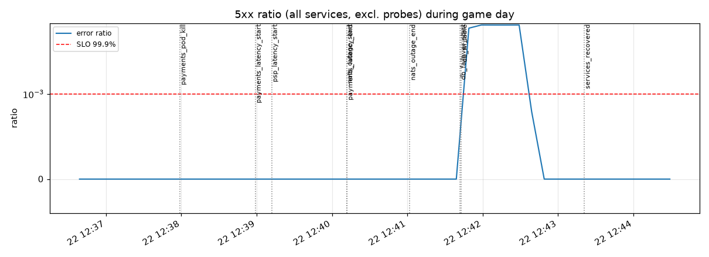
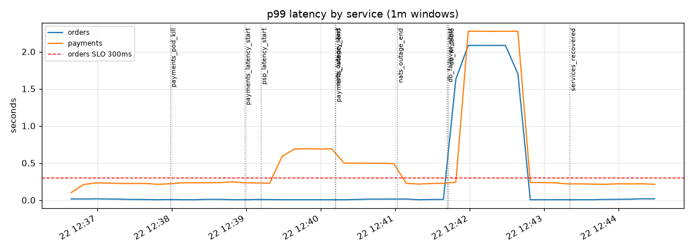
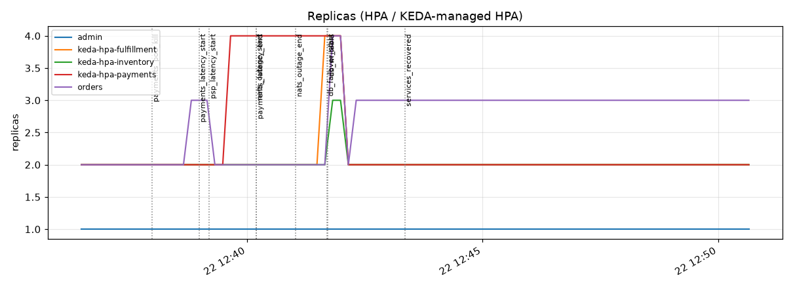
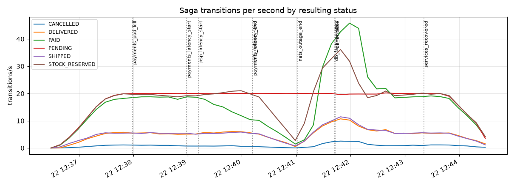
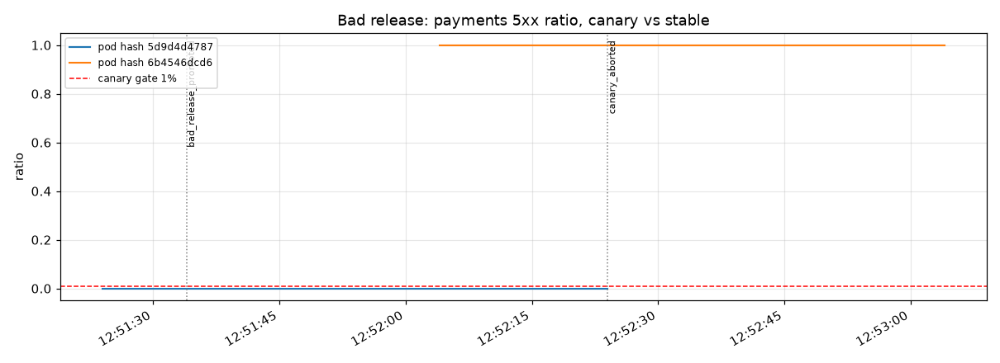

# Proof results

Run: 2026-10-22 12:36:29 to 2026-10-22 12:50:43 (box local time, America/Santiago) on a 2-node kind cluster. Generated by `proof/collect.py` from Prometheus, k6 summaries and Kubernetes objects. Raw data: [`raw/`](raw/).

## Summary

| | Result | Target |
|---|---|---|
| Availability, all services (non-5xx / all) | 99.906% (10 5xx of 10,780) | 99.9% |
| Availability, orders edge | 99.882% | 99.9% |
| Error budget burned in this run (vs 99.9%) | 0.9x the allowed rate | < 1x over 30 days |
| p99 orders (Prometheus, whole run) | 17 ms | < 300 ms |
| p99 payments (Prometheus, whole run) | 495 ms | n/a (internal) |
| 1-minute windows with orders p99 < 300 ms | 86.047% | 99% |
| k6 orders: requests / failed / p99 | 10,713 / 1.083% / 384 ms | |
| Saga transitions | CANCELLED=431, DELIVERED=2,486, PAID=8,127, PENDING=8,591, SHIPPED=2,508, STOCK_RESERVED=8,562 | |
| Saga compensations (CANCELLED + REFUNDED) | 431 | every non-happy path ends compensated |
| DB failover: Postgres killed → writable again | 1.2 s | RTO (kind stand-in) < 60 s |
| DB failover: app pods ready (min during 90 s watch / total), last unready at | 9/16, 97.6 s | no restarts, self-recovery |
| Payments latency injection | NetworkChaos could not inject (kernel without tc netem) → fallback: +300 ms ±100 ms on the PSP that payments calls (simulator fault switch) | |
| Autoscaling events (SuccessfulRescale) | 5 | |
| Bad canary release | auto-aborted | auto-rollback, no human |
| Admission: root pod, no probes/limits | rejected by Pod Security | rejected |
| Admission: PSA-compliant pod without probes/limits | rejected by Kyverno | rejected by Kyverno |

## Timeline

| Time | Event | Detail |
|---|---|---|
| 12:36:29 | `policy_root_pod_rejected` | Error from server (Forbidden): error when creating "proof/manifests/root-pod.yaml": pods "policy-violation" is forbidden: violates PodSecurity "restricted:lates |
| 12:36:29 | `policy_no_probes_pod_rejected` | Error from server: error when creating "proof/manifests/no-probes-pod.yaml": admission webhook "validate.kyverno.svc-fail" denied the request:   resource Pod/or |
| 12:36:29 | `stock_seeded` |  |
| 12:36:29 | `gameday_start` |  |
| 12:37:59 | `chaos_payments_pod_kill` |  |
| 12:38:59 | `chaos_payments_latency_start` |  |
| 12:39:10 | `networkchaos_not_injected` | Not Injected/Wait |
| 12:39:12 | `chaos_psp_latency_start` | {"failure_rate":0.02,"decline_rate":0.05,"latency_ms":300,"jitter_ms":100,"outage":false} |
| 12:40:12 | `chaos_payments_latency_end` |  |
| 12:40:12 | `chaos_nats_outage_start` |  |
| 12:41:02 | `chaos_nats_outage_end` |  |
| 12:41:42 | `chaos_db_failover_start` |  |
| 12:41:43 | `db_writable` | 1.2 |
| 12:43:21 | `services_recovered` | {'db_writable_s': 1.2, 'app_pods': 16, 'min_ready': 9, 'all_ready_after_s': 97.6} |
| 12:50:43 | `gameday_end` |  |
| 12:51:34 | `bad_release_promoted` |  |
| 12:52:24 | `canary_aborted` | RolloutAborted: Rollout aborted update to revision 6: Background analysis phase error/failed: Metric "error-ratio" assessed Failed due to failed (2) > failureLi |
| 12:52:35 | `release_reverted` |  |

## Charts

## Canary analysis (bad release)

| AnalysisRun | Metric | Phase | Successful | Failed | Last value |
|---|---|---|---|---|---|
| payments-6b4546dcd6-2 | p99-latency | Successful | 0 | 2 | [2.6570372916308846] |
| payments-6b4546dcd6-2 | error-ratio | Failed | 0 | 2 | [1] |
| payments-6b4546dcd6-4 | p99-latency | Successful | 0 | 2 | [0.9016666666666666] |
| payments-6b4546dcd6-4 | error-ratio | Failed | 0 | 2 | [1] |
| payments-6b4546dcd6-6 | error-ratio | Failed | 0 | 2 | [1] |
| payments-6b4546dcd6-6 | p99-latency | Successful | 0 | 2 | [1.6172980000000066] |

Canary-phase k6 traffic: 4,200 payments requests, 7.810% failed (includes the 5xx served by the bad canary before it was aborted).

## Autoscaling events

| Time (UTC) | Object | Message |
|---|---|---|
| 2026-10-22T15:39:17Z | keda-hpa-payments | New size: 4; reason: external metric s0-nats-jetstream-ORDERFLOW(&LabelSelector{MatchLabels:map[string]string{scaledobject.keda.sh/name: payments,},MatchExpressions:[]LabelSelectorRequirement{},}) above target |
| 2026-10-22T15:41:17Z | keda-hpa-fulfillment | New size: 4; reason: external metric s0-nats-jetstream-ORDERFLOW(&LabelSelector{MatchLabels:map[string]string{scaledobject.keda.sh/name: fulfillment,},MatchExpressions:[]LabelSelectorRequirement{},}) above target |
| 2026-10-22T15:41:31Z | orders | New size: 4; reason: cpu resource utilization (percentage of request) above target |
| 2026-10-22T15:41:32Z | keda-hpa-inventory | New size: 3; reason: cpu resource utilization (percentage of request) above target |
| 2026-10-22T15:42:01Z | orders | New size: 3; reason: cpu resource utilization (percentage of request) above target |
